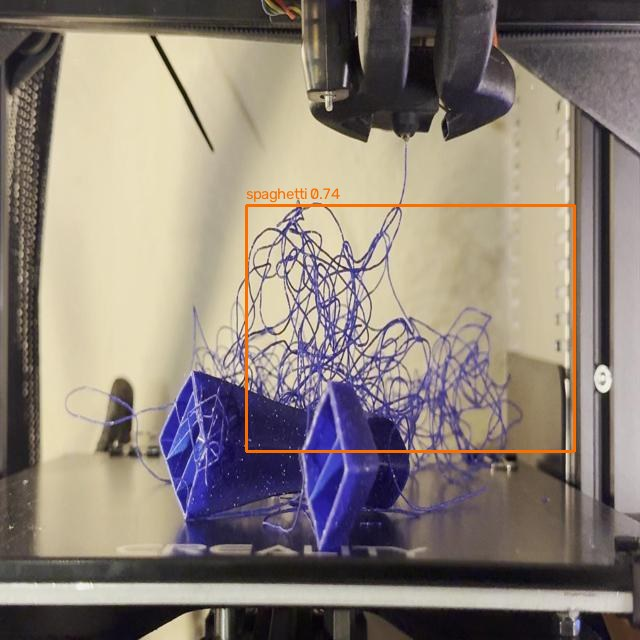
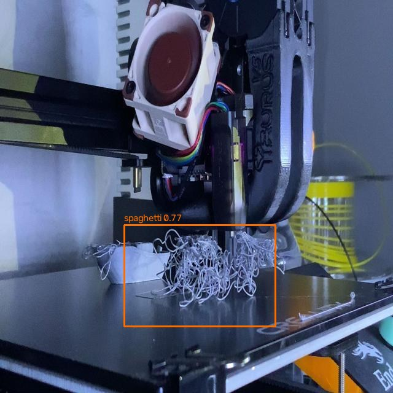
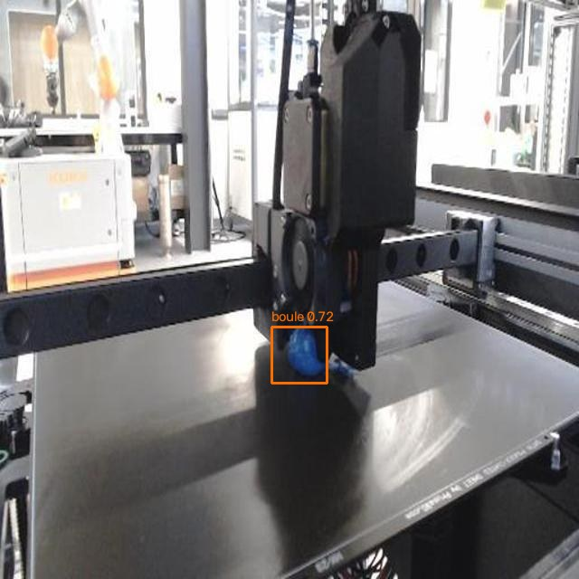

# NoodleWatch

[](#status)
[](https://github.com/Le-Merovingien/NoodleWatch/tree/v0.1.0-beta)
[](#model)
[](#status)
[](https://developer.synaptics.com/docs/developer-kits/coralboard/sl/user-guide)
[](https://www.printables.com/model/1887405-noodlewatch-spaghetti-detection-for-prusa-core-one)
[](LICENSE)

Project page and printable box: [NoodleWatch on Printables](https://www.printables.com/model/1887405-noodlewatch-spaghetti-detection-for-prusa-core-one).

The code and its commands still use the project's working name, `printwatch`.

NoodleWatch watches the print bed through the Coralboard camera. During a print, one image every 5 seconds goes through the "spaghetti" model on the board's NPU. When 3 of the last 5 images show spaghetti, NoodleWatch:
- pauses the print through PrusaLink, or through a local Prusa Connect server;
- saves the annotated image;
- runs the alert command (buzzer and LEDs of the HAT).

Optionally, the box also works as a Prusa Connect camera, in the cloud or on a local server: one photo per minute during the print, the alert image, and a final photo to post the make.

## Example detections

<p>
  
  
  
</p>

Frames from the test set of the "Defect Detection in 3D Printing" dataset (Roboflow, CC BY 4.0, see [CREDITS.md](CREDITS.md)), not used for training, as annotated by NoodleWatch with the NPU simulator at the 0.18 threshold (`boule` is the blob class).

## Status

NoodleWatch has not run on a real Coralboard yet, and the box has not been printed yet. Everything was checked on a PC: installed with `requirements.txt`, the whole program runs with Synaptics' NPU simulator (monitoring loop, detection, pause through PrusaLink or a local Prusa Connect server, each one faked) and uses about 110 MB of memory, well within the board's 2 GB. What is left to check on the hardware is listed under "To check on the board".

## Installation on the board

1. **Network:** the board must reach the printer on your network. For everyday use, fit the M.2 Wi-Fi module (Ampak AP12611_M2, not included) and join the printer's network: see [Attach the Wi-Fi/Bluetooth module](https://developer.synaptics.com/docs/developer-kits/coralboard/sl/user-guide#attach-wifibluetooth-module-optional) in the Coralboard user guide. For the installation alone, network sharing over USB from the PC is enough: see [Connect to a network over USB](https://developer.synaptics.com/docs/developer-kits/coralboard/sl/user-guide#connect-to-a-network-over-usb).
2. **Copy:** connect the board to the PC over USB-C, then copy the folder. Everything goes in `/home/root`: the root partition is small and could fill up.
   ```bash
   adb push printwatch /home/root/
   ```
3. **Python packages:** the Torq runtime that drives the NPU is not on the board's image. Create a virtual environment that keeps the image's own packages (its OpenCV is built with GStreamer, which the camera needs), then install the requirements. The board must be on the network:
   ```bash
   adb shell python3 -m venv /home/root/printwatch-venv --system-site-packages
   adb shell /home/root/printwatch-venv/bin/pip install -r /home/root/printwatch/requirements.txt
   ```
4. **Configuration:** the file must be edited before it goes on the board. On the PC, copy `printwatch/printwatch.ini.exemple` to `printwatch.ini` and fill in the printer's address (`hote`) and the PrusaLink password (`mot_de_passe`), shown on the printer's screen: Settings > Network > PrusaLink. With a local Prusa Connect server, fill in `[connect_local]` instead (see "Local Prusa Connect"). Then copy it to the board:
   ```bash
   adb push printwatch.ini /etc/printwatch.ini
   adb shell chmod 600 /etc/printwatch.ini
   ```
   The file holds the PrusaLink password or the Connect token: `chmod 600` makes it readable by root only.
5. **Automatic start:**
   ```bash
   adb push printwatch/printwatch.service /etc/systemd/system/
   adb shell systemctl enable --now printwatch
   ```

For a first try, set `pause = false` (observation mode): alerts are saved without stopping the print.

## Local Prusa Connect

Instead of PrusaLink, NoodleWatch can go through [Prusa Connect](https://github.com/prusa3d/prusa-connect), the server Prusa released to run at home (public beta 0.1, November 2026). Set `api = connect` in `[imprimante]`, then fill in `[connect_local]`:
- `url`: the server's address, for example `http://192.168.1.10:8080`;
- `jeton`: an API token with the `operate` scope (web app: Settings > API credentials > New credential);
- `imprimante`: the printer's id on the server; leave it empty if the server knows only one printer;
- `camera` (optional): the name of a camera of type `push` declared on the server for this printer. NoodleWatch sends it its photos (one per minute during the print, the alert image, the final photo), in place of the cloud Prusa Connect camera.

The printer must be connected to that server (`prusa_printer_settings.ini` on a USB stick, see the server's documentation), which takes it off the cloud Prusa Connect. PrusaLink keeps working beside it. Tested against a fake server written from the source code of version 0.1.0-beta.1, not against a real server yet: the API of the beta may still change.

## Prusa Buddy3D camera

NoodleWatch can also use the Buddy3D camera inside the CORE One instead of the box camera:
1. In the Prusa app, enable RTSP for the camera. The stream is then available on the local network only, unencrypted.
2. In `printwatch.ini`, set `source = rtsp://<camera IP>/live`.

The stream is read continuously in the background, so each analysis uses the latest image, and NoodleWatch reconnects on its own if the stream drops. With the Buddy3D, nothing needs to be mounted on the door: the program can run on the board anywhere on the network, or on a PC with `materiel = tflite` (see "Running on a PC with uv"). On a PC, also point `dossier` (`[alerte]`) and `fichier` (`[journal]`) to places you can write to: the example paths are the board's.

Not yet tested with a real Buddy3D camera.

## Running on a PC with uv

On a PC (Linux, macOS or Windows), [uv](https://docs.astral.sh/uv/) installs Python and the packages from `pyproject.toml` and `uv.lock`. The `pc` extra brings `opencv-python` and `ai-edge-litert`, for `materiel = tflite`:
```bash
cp printwatch/printwatch.ini.exemple printwatch.ini      # then set materiel = tflite, dossier and fichier
uv run --extra pc printwatch printwatch.ini
```
Relative paths in `printwatch.ini` are relative to the file itself, for example `dossier = printwatch-data/alertes`. `printwatch.ini` and `printwatch-data/` are in `.gitignore`, so the password stays out of git.

The `npu` extra brings `torq-runtime` (x86-64 or aarch64 Linux, Python 3.12 or later), for `materiel = sim`: `uv run --extra pc --extra npu printwatch printwatch.ini`. On the board, keep the installation above: `requirements.txt` in a venv that keeps the image's OpenCV.

## To check on the board

These points could not be checked without the hardware:
- **Camera:** `source` uses the GStreamer pipeline of Synaptics' examples on `/dev/video0` (OpenCV's own V4L2 access can block forever on this board). If the OV5647 is on another node, find it with `v4l2-ctl --list-devices`. Its exposure is set at start-up and at each print start, as in Synaptics' examples, because the sensor's auto exposure leaves frames black.
- **Board image:** Synaptics tested its SL2610 examples with Torq 2.3 on the scarthgap 6.12 v2.5.0 (Coralboard I/O Edition) and v2.6.1 images. The model is compiled with Torq 2.3.0.
- **Alert:** the command that drives the HAT's buzzer and LEDs is still to be written, because their pins are not documented.
- **Buddy3D:** decoding the HD stream continuously uses some CPU on the board; not measured yet.
- **Heat:** the board sits in a closed box, against door glass warmed by the chamber (long ASA or ABS prints).
- **Focus:** the OV5647 module is fixed-focus, normally sharp from about 1 m to infinity, while the nozzle is closer.
- **Reflections:** the door glass can reflect the LEDs of the board and the HAT, or the printer's lighting, into the lens.
- **NPU inputs and outputs:** the program passes NumPy arrays to `torq.runtime.VMFBInferenceRunner` (`printwatch/detecteur.py`), whereas Synaptics' examples use device-backed I/O (`device_io=True`, needed by the default dmabuf allocator according to their comment). If inference fails on the board, look here first.

## Model

YOLOv8n at 320 × 320, two classes: spaghetti and blob ("blob of death", class name `boule`). It is trained on the Roboflow datasets "3D printing failure" and "Defect Detection in 3D Printing" (CC BY 4.0, see [CREDITS.md](CREDITS.md)), then converted to int8 and compiled for the SL2610's NPU. The application alerts on either class.

Results on the NPU simulator, at a threshold of 0.18, on 1,565 images the model has never seen (half of "Defect Detection", split by original photo, with no duplicates of the training set):
- **85 %** of spaghetti images are detected by the spaghetti class (61 out of 72), and 88 % trigger an alert;
- **74 %** of blob images are detected by the blob class;
- **12 %** of images with another defect (strings, under-extrusion, clogged nozzle…) are wrongly flagged, image by image. The 3-out-of-5 filter discards isolated cases.

## License and credits

NoodleWatch is released under the GNU Affero General Public License v3.0 (see [LICENSE](LICENSE)), because the model is trained with Ultralytics YOLOv8, which is under AGPL-3.0.

The training datasets come from Roboflow Universe, under CC BY 4.0: see [CREDITS.md](CREDITS.md).
